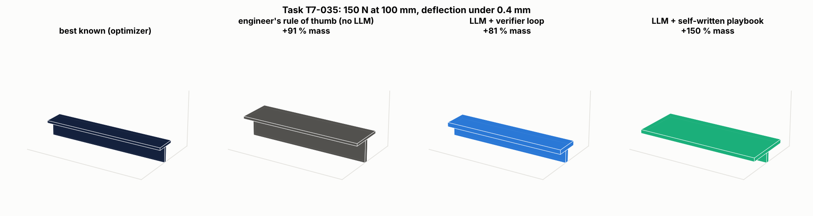
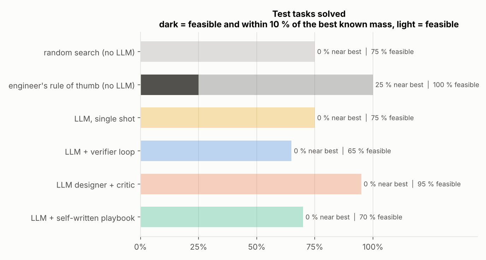
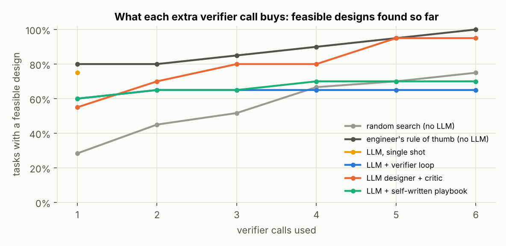

# agentic-design-bench

**A benchmark for LLM agents that size engineering parts: the agent proposes a design, deterministic verifiers
check it, the agent revises, and it writes its own playbook of lessons to improve on the next parts. No answer key
is ever shown to the agent; an optimizer finds the best known design only to score it.**

  



## The question

Engineering agents rarely have a ground-truth answer: there is no single "correct" bracket, only designs that pass
or fail checks and that are lighter or heavier. So how do you know whether an agent setup (prompt, tools, memory,
a second agent as critic) is actually better? This repository answers with a small, strict benchmark:

* **30 sizing tasks** for a machined cantilever bracket (flange plus optional rib): load, length, deflection limit,
  safety factor, bolt size, envelope and allowed materials vary from task to task. 10 dev tasks, 20 test tasks.
* **A verifier tool** the agent calls: beam theory with a stress concentration at the bolt holes, mass, cost, and
  six manufacturing rules (minimum wall, rib slenderness, edge distance, envelope, 0.5 mm machining grid, allowed
  material). It returns numbers and the list of broken rules, never the answer.
* **The same budget for everyone**: six verifier calls per task.
* **Scoring without showing the answer**: a differential-evolution optimizer finds the best known design of each task
  offline. An agent succeeds when its best feasible design is within 10 % of that mass.

| Component | Where |
|---|---|
| Verifier: section properties, stress, deflection, mass, rules | [`designbench/physics.py`](designbench/physics.py) |
| Task generator and reference optimizer | [`designbench/tasks.py`](designbench/tasks.py) |
| Agents and the self-improvement step | [`designbench/agents.py`](designbench/agents.py) |
| OpenAI-compatible client with cache and rate limit (Gemini, Groq, Mistral, OpenAI, Ollama) | [`designbench/llm.py`](designbench/llm.py) |
| Scoring and paired bootstrap | [`designbench/bench.py`](designbench/bench.py) |

## The agents

| Agent | How it works |
|---|---|
| random search (no LLM) | six random designs in the allowed ranges |
| engineer's rule of thumb (no LLM) | starts deep and ribbed, fixes what the verifier flags, then trims |
| LLM, single shot | one proposal from the specification, no feedback |
| LLM + verifier loop | propose, read the verifier report, revise, six times |
| LLM designer + critic | after each report, a second agent (senior structural engineer) tells the designer what to change |
| LLM + self-written playbook | on the 10 dev tasks, after each task the agent writes general lessons from its own trace (verifier feedback only) and merges them into a playbook of at most 8 lessons; the playbook is then frozen and used on the 20 test tasks |

The self-improvement step never sees the answer key: the agent only learns from what the verifier told it, which is
the situation of a real engineering agent.

## Results: qwen2.5:14b on the 20 test tasks



<!-- RESULTS:START -->
| Agent | Within 10 % of best known | Feasible | Median mass vs best known | LLM calls per task |
|---|---:|---:|---:|---:|
| random search (no LLM) | 0 % | 75 % | +173 % | 0.0 |
| engineer's rule of thumb (no LLM) | 25 % | 100 % | +59 % | 0.0 |
| LLM, single shot | 0 % | 75 % | +213 % | 1.0 |
| LLM + verifier loop | 0 % | 65 % | +80 % | 6.0 |
| LLM designer + critic | 0 % | 95 % | +73 % | 11.0 |
| LLM + self-written playbook | 0 % | 70 % | +158 % | 6.0 |

Model: `qwen2.5:14b` through `ollama`, 560 calls, 393,791 tokens.
* LLM designer + critic vs verifier loop, paired over the same tasks: +0 points of success (95 % interval +0 to +0); +30 points of feasible designs (95 % interval +10 to +50).
* LLM + self-written playbook vs verifier loop, paired over the same tasks: +0 points of success (95 % interval +0 to +0); +5 points of feasible designs (95 % interval -15 to +25).

Playbook the agent wrote for itself on 10 dev tasks, then used frozen on the 20 test tasks:

1. Maintain sufficient width to ensure structural integrity and comply with design constraints such as edge distance requirements.
2. Gradually reduce thickness to minimize weight while monitoring stress levels to ensure the safety factor is maintained.
3. Adjust dimensions incrementally to approach the optimal balance between weight and structural requirements, ensuring feasibility at each step.
4. Ensure that the chosen dimensions do not exceed the structural integrity limits, especially the safety factor on yield stress.
5. Optimize dimensions to reduce deflection while maintaining material efficiency.
6. Choosing a material with a higher yield strength can allow for a lighter design while meeting safety factor requirements.
7. Ensure that the chosen dimensions do not exceed the envelope constraints, especially the height and width limits.
8. Choosing the right material is crucial for balancing weight and strength requirements, with lighter materials like aluminium offering a good compromise for many applications.
<!-- RESULTS:END -->



What this run shows (`qwen2.5:14b` on a cloud T4 GPU through Ollama, the playbook learned on the 10 dev tasks, the
20 test tasks never seen before, the same six verifier calls for every agent):

* **The verifier loop is what makes designs light**: going from one shot to a propose, check, revise loop cuts the
  median excess mass from +213 % to +80 %. Feedback from a deterministic tool is the first thing worth building.
* **With a 14B model, the critic pays off**: a second agent acting as senior engineer lifts feasible designs from
  65 % to 95 % (+30 points, 95 % paired interval +10 to +50) and keeps the lightest designs of all LLM setups
  (+73 %), at the price of 11 LLM calls per task instead of 6.
* **The self-written playbook still hurts**: 70 % feasible and +158 % mass, worse than the plain loop. Its lessons
  are generic ("gradually reduce thickness", "choose the right material"), and one even pushes aluminium in
  general; none states the lever that matters here, a thin flange with a deep, thin rib at the slenderness limit.
  Lesson quality, not lesson count, decides whether memory helps.
* **No LLM agent reaches the best known design within 10 %, and the rule of thumb is still the reference**: always
  feasible, +59 % mass, within 10 % on 25 % of the tasks. Random search is feasible 75 % of the time but never
  close to the optimum, which is why feasibility alone is a weak metric.

### Does model size change the picture?

Same six test tasks, same budget, a 3B model on a laptop CPU against a 14B model on a GPU:

| Agent | 3B feasible | 3B median mass | 14B feasible | 14B median mass |
|---|---:|---:|---:|---:|
| LLM, single shot | 33 % | +435 % | 67 % | +238 % |
| LLM + verifier loop | 50 % | +273 % | 67 % | +81 % |
| LLM designer + critic | 33 % | +266 % | 100 % | +73 % |
| LLM + self-written playbook | 17 % | +543 % | 50 % | +150 % |

Every setup improves with the larger model, but not by the same amount: the critic goes from useless to the best
LLM setup, while the playbook stays behind the plain loop at both sizes. Which part of an agent brings value
depends on the model behind it, so an agent design has to be benchmarked again whenever the model changes. That
is the point of this repository.

The picture at the top of this page shows where the gap lies, on test task T7-035: the verifier loop finds a ribbed
section (+81 % mass), while the playbook agent falls back on a thick flat flange (+150 %), the least efficient way to
add stiffness. The optimizer goes further, with a thin flange and a deep, thin rib at the slenderness limit.

## Run

```bash
pip install -r requirements.txt
pytest -q                                  # 8 tests, a scripted stand-in replaces the LLM
python run.py                              # baselines without an LLM
python run.py --backend gemini             # all LLM agents, about 500 calls, cached on disk
python run.py --backend groq --quick       # 5 dev and 10 test tasks, for a tight free tier
python run.py --backend ollama --model qwen2.5:14b   # local or Colab GPU model, no key, full split
python run.py --report                     # redraw figures and this README section
```

The key is read from an environment variable (`GEMINI_API_KEY`, `GROQ_API_KEY`, `MISTRAL_API_KEY`,
`OPENAI_API_KEY`; Ollama needs none) and never written in the code. Every answer is cached in `.cache/`, so a rerun is free and the
results can be reproduced exactly. `--rpm` sets the request rate allowed by your plan.

## Limits

* 20 test tasks and one run per agent: the paired bootstrap over tasks gives an interval (shown above), but not
  the variation from one run of the same model to the next. Success within 10 % stays at zero for every LLM agent,
  so the comparisons rely on feasibility and mass.
* Open models up to 14B parameters. A frontier model through `--backend gemini`, `mistral` or `openai` is the next
  run; every answer is cached, so results stay reproducible.
* The verifier is beam theory with an approximate stress concentration, not finite elements. It is deliberately fast
  and transparent so that hundreds of agent steps cost nothing; a FEA verifier would plug in the same way.
* The playbook is learned on 10 tasks only; testing lessons validated on dev tasks (keep a lesson only if it improves
  the dev score), and whether they transfer to another part family, are the natural next experiments.

## License

MIT
